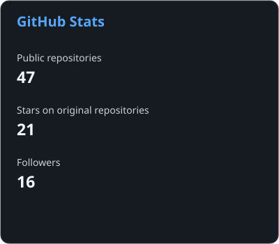
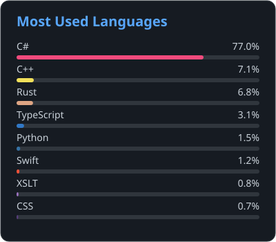

<!--
**LuigimonSoft/LuigimonSoft** is a ✨ _special_ ✨ repository because its `README.md` (this file) appears on your GitHub profile.

Here are some ideas to get you started:

- 🔭 I’m currently working on ...
- 🌱 I’m currently learning ...
- 👯 I’m looking to collaborate on ...
- 🤔 I’m looking for help with ...
- 💬 Ask me about ...
- 📫 How to reach me: ...
- 😄 Pronouns: ...
- ⚡ Fun fact: ...
-->

# Hi there, 👋

I am a passionate programmer who enjoys learning new things. Although I am not tied to a single programming language or framework, I use C#, TypeScript, JavaScript, Vue, and SQL for work, while C++ and Rust are my favorite languages for hobby projects. I have also worked with other programming languages and frameworks like Python, React, Angular, jQuery, Bootstrap, etc. I enjoy creating using design patterns and utilizing SOLID methodology, and strongly-typed languages are where I apply it the most. However, I am always looking for new ways to apply it to untyped languages. I mostly focus on backend development, but I also work on frontend activities. My dream is to develop video games or tools for game development teams.
## 🔨 Languages and Tools

## 📊 GitHub Stats

Language percentages are based on code in public, non-fork repositories.

## 🛠️ My Projects

- [**IntelligentReportsStudio**](https://github.com/LuigimonSoft/IntelligentReportsStudio) — A cross-platform desktop report designer for creating reusable, data-driven documents and exporting them to PDF.
- [**rquery-orm**](https://github.com/LuigimonSoft/rquery-orm) — A lightweight Rust ORM with a SQL-style query builder for SQL Server and PostgreSQL.
- [**Rust-Base-Backend**](https://github.com/LuigimonSoft/Rust-Base-Backend) — A Rust backend foundation built with clean architecture and the services-repositories pattern.
- [**DapperEntityORM**](https://github.com/LuigimonSoft/DapperEntityORM) — An entity-based ORM built on Dapper.
- [**MSSQLAdministracion**](https://github.com/LuigimonSoft/MSSQLAdministracion) — Queries for administering and troubleshooting SQL Server.

[Explore all my repositories →](https://github.com/LuigimonSoft?tab=repositories)

## CodeWars

